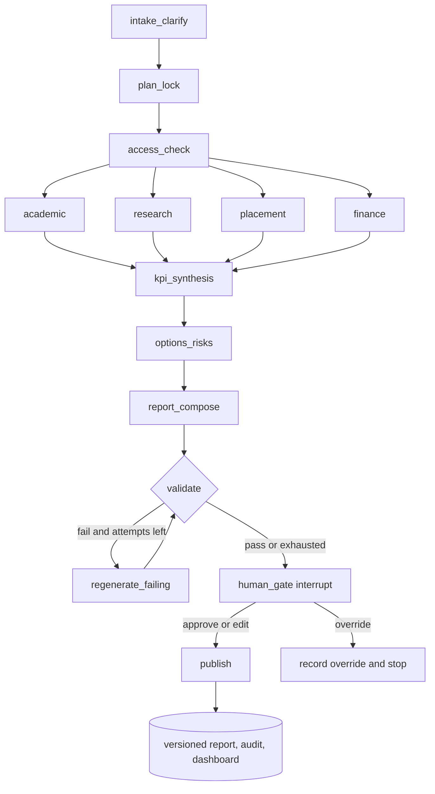

# ARCHITECTURE

Everything here is provisional where docs/DECISIONS.md says so. The principles are not.

## 1. Principles

1. Deterministic where it can be, agentic where it adds value. KPI math, aggregation, variance, versioning and checks are plain tested code. The LLM clarifies requests, drafts options and risks, and explains. Be honest about this split; it is the defence against hallucinated numbers.
2. Numbers by reference. The LLM output contains tokens like `{{kpi:AC_PASS_PCT}}` or `{{fact:8841}}`. A renderer resolves them from the database. A lint rejects any other digit in LLM text (allowlist: financial year labels, dates). That lint is check V1.
3. Ingest, then serve. Source systems are read by adapters into immutable, batch-versioned `metric_fact` rows. The connector serves from that store. Runs are reproducible and evidence ids never change under a report. "Real-time" means the ingestion cadence plus an on-demand refresh button, with an as-of date on every figure.
4. One door to data. Agents reach data only through the connector. A test fails the build if an agent module imports a database or file reader.
5. Provider-agnostic LLM. One factory, one interface, swapped by config.

## 2. Layers

| Layer | Component | Notes |
| --- | --- | --- |
| Sources | CSV or Excel drop folder, read-only SQL views, optional API | Adapters, one class each |
| Ingestion | Validator and loader | Rejects rows missing status or as_of, records batch id and source ref |
| Store | PostgreSQL 16 with pgvector | Facts, KPI defs, targets, results, runs, briefs, versions, audit, users |
| Connector | MCP server | Typed read tools, scoped tokens, every call audited |
| KPI engine | Python package | Safe formula evaluation (no eval), Decimal arithmetic, weighted aggregation |
| Agent graph | LangGraph | See section 3 |
| LLM layer | Provider factory | Ollama or vLLM through an OpenAI-compatible endpoint, hosted only in synthetic mode |
| API | FastAPI | REST plus SSE for run progress |
| UI | Next.js | See docs/UI_SPEC.md |
| Governance | Versioning, rollback, audit, RBAC | Hash-chained audit table |

## 3. Agent graph



Notes:

- The Coordinator is the graph plus the runtime wrapper (budgets, audit, checkpoints). It is not a separate LLM agent. Say this plainly in the viva.
- `access_check` is sequential. The four domain nodes run in parallel using LangGraph's fan-out (`Send`) with a join before `kpi_synthesis`.
- `options_risks` fans out per off-target KPI so options are drafted in parallel.
- On exhaustion, the graph still reaches the human gate, flagged `escalated` with the diagnosis. The human can override or send it back.
- `human_gate` uses LangGraph's interrupt. Resume carries the decision, the actor, edits and the reason.

### State (Pydantic)

```
RunState:
  run_id, request, clarifications[], plan (locked, immutable after plan_lock)
  scope: {domain: ScopeGrant}
  domain_views: dict[domain, DomainView]      # merged by a dict reducer
  kpi_results: list[KpiResult]
  options: list[OptionSet]                    # per KPI
  brief: Brief (draft)
  validation: ValidationReport | None
  attempts: int
  gate: GateDecision | None
  published_version: int | None
```

Run state (short term, checkpointed) is kept separate from the archive (long term: approved briefs, history, embeddings). Mixing them corrupts the baseline.

## 4. Connector (MCP server)

The agents' only way to data is the `Connector` protocol (`app/agents/connector.py`). It has three implementations: in memory over the store (`app/services/connector.py`), an MCP client (`app/mcp_connector/client.py`), and, for runs, `RunConnector`, which answers with the current run's own MCP session.

The MCP server (`app/mcp_connector/server.py`, mcp 2.3) serves each protocol method as a read-only tool: `get_calendar`, `list_departments`, `get_kpi_definitions`, `get_targets(period)`, `get_domain_metrics(domain, period)`, `get_publications(period)`, `get_data_health(period)`, `get_scope_grants`, `get_evidence(fact_id)`, `get_source(id)`. It is mounted in the API process at `/mcp` (decision D29) and used when `CONNECTOR_URL` points at it, as `make demo`, `make up` and `make rehearse` do.

Each run gets a bearer token when its plan is locked (`app/mcp_connector/tokens.py`): scopes `read:<area>` for the plan's areas plus `read:reference`, an expiry, and revocation when the run stops. A read outside the token's areas is refused. Every call and every refusal is one audit row: who, the tool, the arguments, and a hash of the answer. Not built from the original list: `get_external_benchmarks`, and `framework` filters on definitions and targets, which wait for IQAC (rule 12). `langchain-mcp-adapters` is not used: the graph needs the typed protocol, not LangChain tools.

## 5. LLM layer

`agents/llm.py` exposes `get_chat_model(role, settings, system_config)`. The app uses the roles `clarifier` and `drafter`; `judge` is reserved and unused, because the nine checks are code, not a model. Embeddings are separate (`app/db/embeddings.py`) and refuse any server that is not local.

Config:

```
DATA_MODE=synthetic | real
LLM_PROVIDER=ollama | openai_compat | hosted
LLM_BASE_URL=http://localhost:11434/v1
LLM_MODEL=<chosen after checking what the hardware can serve>
LLM_EMBED_MODEL=<local embedding model>
ALLOW_HOSTED_LLM=false
```

Rules:

- The factory reads `data_mode` from the database `system_config` table, not only from the env. If data_mode is real and the provider is hosted, refuse to start and refuse at call time.
- Structured outputs through Pydantic with validation and a bounded repair retry. Temperature low. Small local models are weaker at tool calling, so the nodes that use the LLM take no tools. They take structured prompts and return structured JSON. Tools are called by deterministic nodes.
- A `FakeLLM` returns canned structured outputs for tests and for demo fallback. The whole graph must run end to end on FakeLLM in CI.
- Tracing: `LANGCHAIN_TRACING_V2=false` enforced at startup. Observability is the audit table and run trace UI.

## 6. Persistence

Two modes behind the same services. In memory (the default, the demo and most tests), or with `EDSS_DATABASE=true` in PostgreSQL 16 with pgvector (`compose.yaml`, on 127.0.0.1):

- Schema as SQLAlchemy Core tables (`app/db/schema.py`), one per data-contract table, migrated by Alembic (`backend/migrations`, `make db-migrate`). Figures are NUMERIC.
- The services keep their rules and write every change through (decision D31): data (`dataset_store.py`), people, grants and the data mode (`state_store.py`), runs, briefs, versions and the pointer (`work_store.py`), the audit log (`audit_store.py`). The data mode is read from `system_config` on every call.
- The app connects as `edss_app`, which cannot update, delete or truncate the audit log; a trigger refuses those to the owner too (migration 0004). Audit writers take an advisory lock, so the chain stays gapless across processes.
- LangGraph's Postgres checkpointer (`checkpoints.py`), so a run survives a restart.
- Prior briefs embedded locally (nomic-embed-text through Ollama, or a word-hashing stand-in) and searched by cosine distance behind an HNSW index (`archive_store.py`). Every published report is added.
- Real data is loaded from the command line, append-only (`real_data.py`, decisions D32 to D34). Synthetic and real records share the tables and are read by mode.
- Backups with `pg_dump`, proven by restoring them (`backup.py`, `make db-backup`).

## 7. Governance

- Brief states: `draft`, `escalated`, `approved`, `published`, `rolled_back`, `overridden`.
- Publish creates an immutable `brief_version`. A `current_version` pointer moves forward. Rollback moves the pointer and writes an audit row. History is never edited.
- Approval requires a role with `can_approve` and a draft with a green validation report (or an `escalated` flag acknowledged by the approver).
- Audit table is append-only with `prev_hash` and `hash` per row. A verifier script recomputes the chain. The database role used by the app has no UPDATE or DELETE on the audit table.

## 8. Repo layout

```
edss/
  CLAUDE.md  PROGRESS.md  Makefile  compose.yaml  .env.example
  docs/                  this file, SPEC, DATA_CONTRACT, DECISIONS, DEMO, RUNBOOK, SLIDES_KIT, VIVA_NOTES,
                         evals/, diagrams/, demo-screens/, ci/ (the workflow, staged)
  backend/
    Dockerfile  pyproject.toml  uv.lock  alembic.ini  migrations/
    app/
      api/               routes (auth, runs, briefs, reports, kpis, data health, audit, admin, system, demo), schemas
      core/              config, security, rbac, throttle, tracing guard, canonical form
      domain/            enums, models, dataset
      kpi/               engine, formulas (restricted AST), catalogue, definitions/ (placeholder YAML)
      ingestion/         adapters (csv, read-only sql), validator, loader (ledger), manifest, reconcile, export
      agents/            graph, connector protocol, llm and llm_http, fake_llm, prompts, compose, repair,
                         runtime, frameworks; skills/ (plan, options); validation/ (checks V1 to V9, faults, suite)
      mcp_connector/     server, client, tokens, run context
      specialists/       framework packs (strategic, NIRF, NAAC) as YAML over one implementation
      services/          store, connector, runs, users, archive, views, refresh, demo state, system config
      governance/        service (decisions, versions, rollback), audit (hash chain)
      db/                schema, the database stores, checkpoints, embeddings, real data, backup, urls
      synthetic/         generator, traps
    tests/
  frontend/              Next.js app, Dockerfile, e2e/ (Playwright), rehearse/ (the demo walked)
  data/
    sample/              synthetic, committed
    real/                gitignored, never committed
  scripts/               demo, rehearse helpers, seed, ingest, acceptance, benchmark, evaluate_llm,
                         db_check, db_roles, db_backup, create_user, smoke_clean_clone, export_openapi
```

## 9. Deployment

`compose.yaml` with services `db`, `migrate` (one-shot: schema, the app role, checkpoint tables, the synthetic seed), `backend` (database mode, MCP on) and `frontend`, with health checks, on 127.0.0.1 only. `make up` brings it all up; `make smoke` proves it from a fresh clone; `docs/RUNBOOK.md` is for the IT cell. The connector is not a separate service (D29), and the model server is the host's Ollama or the university's vLLM, configured by env. Not built: HTTPS in front, SSO.

## 10. Testing

- Unit and integration (pytest): the KPI engine and formula safety, every validation check, RBAC and HOD scoping on what is sent, the graph on FakeLLM including crash and resume, the planner and drafter with scripted models, the MCP server, client and tokens over real HTTP, the swap test (identical KPIs through MCP and directly).
- Failure injection: the eight faults, each caught by its intended check and repaired (`make acceptance` measures 94 trials over 18 plans).
- Database (`make test-db`): migrations, the data round trip with every trap, people and grants, the audit role and trigger, concurrent writers, restarts, checkpoints, pgvector search, backups, real data. `make test-api-db` runs the API suite again in database mode.
- Browser (Playwright): approval and rollback, fault injection, scoping, sign-in and lockout, keyboard use, an accessibility scan; `make rehearse` walks the nine demo steps at projector size.
- Benchmark: parallel against one at a time (`make benchmark`). Model evaluation: `scripts/evaluate_llm.py`, results in `docs/evals`.
- Containers: `make smoke`.

## 11. Security notes

Parameterised queries only. Formula evaluator is a restricted AST evaluator, never `eval`. Tokens scoped per tool and per department set. Secrets from env, never committed. Uploaded files validated by type and size. Authorisation tests for every route, especially HOD scoping.
