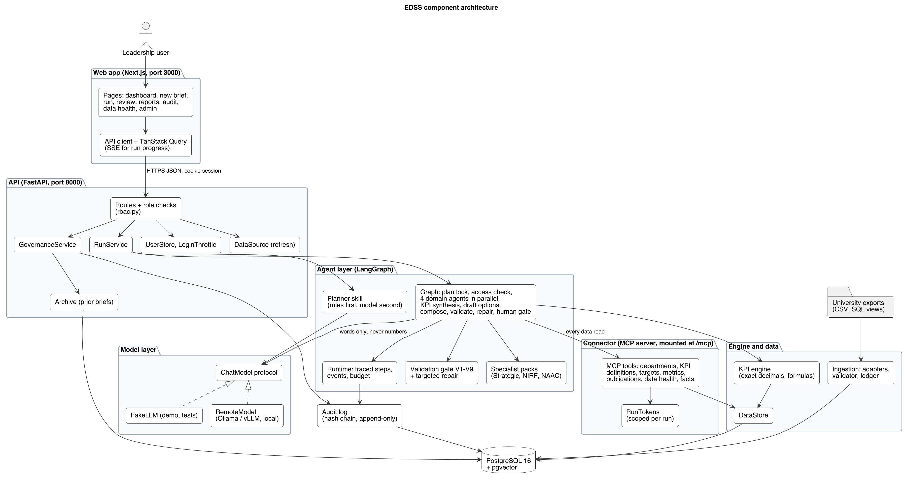

# 3. Architecture

Diagrams: `uml/png/02_architecture.png` (components), `uml/png/12_deployment.png` (deployment), and the slide versions in `docs/diagrams/`. The longer narrative is `docs/ARCHITECTURE.md`.

## 3.1 Layers

| Layer | Responsibility | Main code |
| --- | --- | --- |
| Web app | Pages for each role, drill-down, live run progress over SSE, approval screen | `frontend/src/app`, `frontend/src/components` |
| API | HTTP routes, sessions, role and department scoping, services | `backend/app/api`, `backend/app/services`, `backend/app/core/rbac.py` |
| Agent layer | Planner skill, the LangGraph graph, option drafting, validation and repair, specialist packs, runtime tracing | `backend/app/agents`, `backend/app/specialists` |
| Connector | The only way agents read data: an MCP server with per-run scoped tokens; every call audited | `backend/app/mcp_connector` |
| Engine and data | KPI engine (formulas, exact decimals), data store, ingestion (adapters, validator, ledger) | `backend/app/kpi`, `backend/app/services/store.py`, `backend/app/ingestion` |
| Governance | Approval, edit, override, versions, rollback, diff, archive of prior briefs, the audit chain | `backend/app/governance`, `backend/app/services/archive.py` |
| Storage | PostgreSQL 16 with pgvector; LangGraph checkpoints; append-only audit table | `backend/app/db`, `backend/migrations` |
| Model layer | One `ChatModel` protocol: FakeLLM for the demo and tests, a local OpenAI-compatible model (Ollama now, vLLM on a GPU later) | `backend/app/agents/llm.py`, `fake_llm.py`, `llm_http.py` |

## 3.2 The agent graph

Built in `build_graph()` (`backend/app/agents/graph.py`). Diagram: `uml/png/06_sequence_brief.png`, and the slide version `docs/diagrams/2-agent-graph.png`.

| Node | What it does | Uses the model |
| --- | --- | --- |
| `plan_lock` | Records the locked plan | No |
| `access_check` | Checks the Registrar's grants for each planned area | No |
| `domain_agent` x4 | Academic, Research, Placement, Finance in parallel (LangGraph `Send`), each reading only through the connector | No |
| `kpi_synthesis` | The join: the KPI engine computes every planned KPI with target, variance and status | No |
| `draft_options` (one per off-target KPI, in parallel) | Drafts two or three options with risks, trade-offs and assumptions, guided by a specialist pack | Yes, words only |
| `report_compose` | Assembles the brief: figures, options, assumptions, data health | No |
| `validate` | Checks V1 to V9 | No |
| `regenerate` | Repairs only the failing parts; back to `validate` at most 3 times | Only to redraft an option |
| `prepare_gate`, `human_gate` | Creates the draft (green or escalated) and pauses for a person (LangGraph interrupt) | No |
| `finish` | Records the decision | No |

The planner (clarify, propose, revise) runs before the graph: rules read the request first, the model only fills what the rules could not, and a person edits and locks the plan.

## 3.3 Connector (MCP)

An MCP server (Python MCP SDK 2.3) mounted in the API at `/mcp` (decision D29). Each run gets a bearer token scoped to its plan's areas plus reference data; it expires with the run. Tools: `get_calendar`, `list_departments`, `get_kpi_definitions`, `get_targets`, `get_domain_metrics`, `get_publications`, `get_data_health`, `get_scope_grants`, `get_evidence`, `get_source`. Every call writes `connector.call` to the audit log with a hash of the answer; a read outside the token's areas is refused and written as `connector.refused`. Sequence: `uml/png/08_sequence_mcp.png`.

## 3.4 Data flow

1. Department exports (CSV, read-only SQL views) are checked row by row; refused rows carry a plain reason. Accepted rows become immutable batches of `metric_fact` records with their source, reference, as-of date and status.
2. Agents read those records through the connector; the KPI engine turns them into institution figures from totals.
3. The model writes words around reference tokens; the brief is validated, repaired if needed, and handed to a person.
4. An approved brief becomes a numbered, immutable report version; rollback moves the pointer and deletes nothing. Every step is in the hash-chained audit log.

## 3.5 Technology stack, and why

| Concern | Choice | Why this, and the alternative not taken |
| --- | --- | --- |
| Orchestration | LangGraph 1.2 | Parallel fan-out (`Send`), checkpoints that survive a restart, and a built-in interrupt for the human gate. Plain Python would rebuild all three; CrewAI hides the control flow the validation loop needs |
| Connector | MCP (Python SDK 2.3) | The book's Lab 5 asks for an MCP-style connector; one protocol for every source, scoped tokens per run. A direct database client would let agents touch data (rule 6) |
| API | FastAPI, Pydantic 2 | Typed request and response models, an OpenAPI contract that generates the frontend's types |
| Storage | PostgreSQL 16 + pgvector | One database for facts, runs, briefs, the audit chain, checkpoints and similar-brief search. A separate vector store would be a second system to secure |
| Model | Local first: Ollama (qwen3.5 4B) now, vLLM on a university GPU later | Rule 7: real data never leaves the machine. Hosted models are allowed only on synthetic data |
| Web app | Next.js 16, React 19, TypeScript, Tailwind, shadcn/ui, ECharts, TanStack Query | Typed end to end, accessible components, SSE for live progress |
| Tests | pytest, Vitest, Playwright with axe | Unit, component, browser and accessibility tests in one `make` target each |
| Packaging | Docker Compose | One command on any server; the database, migrations, API and web app as four containers |
