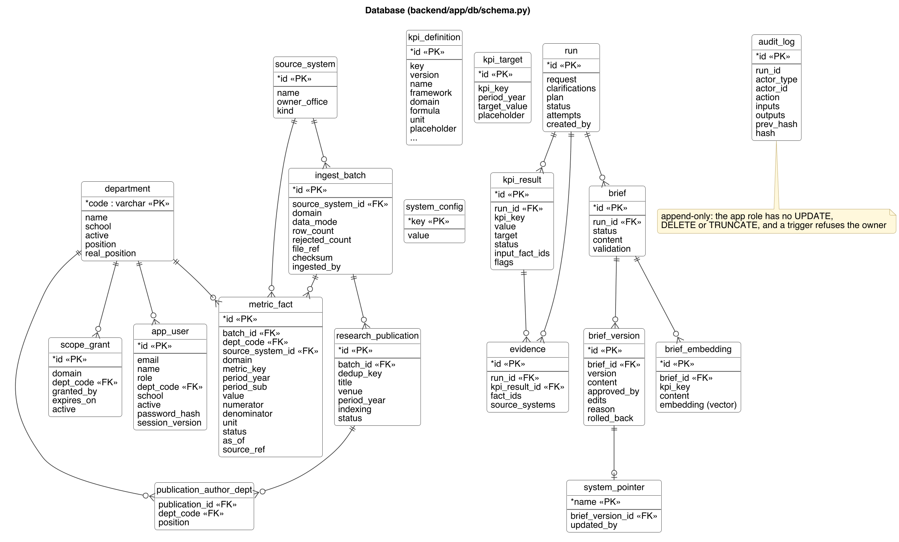

# 6. Database design

PostgreSQL 16 with the pgvector extension. Tables are SQLAlchemy Core definitions in `backend/app/db/schema.py`; the schema is built by Alembic migrations in `backend/migrations/versions/`. Entity-relationship diagram: `uml/png/13_er_database.png`.

## 6.1 Tables

| Table | Holds | Notes |
| --- | --- | --- |
| `department` | Departments, school, active flag, display order (synthetic and real lists kept apart) | Primary key `code` |
| `source_system` | Each source office and system (for example "Placement Cell offers view") | Every record points to one |
| `ingest_batch` | One loaded file or view: area, data mode, row and reject counts, checksum | Same checksum twice adds nothing |
| `metric_fact` | One figure: department, metric, period, value, numerator and denominator, unit, status, as-of date, source reference | Never updated; a newer batch supersedes per slot, older rows stay so old briefs still resolve |
| `research_publication`, `publication_author_dept` | Papers, de-duplicated by key, credited to every department that shares them | A shared paper counts once for the institution (check V9) |
| `kpi_definition`, `kpi_target` | KPI formulas, units, precision, at-risk band, placeholder flag, version; targets per year | All 13 marked `PLACEHOLDER_PENDING_IQAC` until IQAC supplies them |
| `scope_grant` | The Registrar's authorisation per data area, with expiry | Checked at the start of every run |
| `run` | A brief request: questions, answers, plan, status, attempts | Written through on every change |
| `kpi_result`, `evidence` | Each run's figures and the records behind them | For drill-down and audit |
| `brief`, `brief_version` | Drafts and published versions with edits, reasons and rollback marks | Versions are never edited |
| `system_pointer` | Which version is current | Rollback moves this pointer only |
| `brief_embedding` | Words of past briefs as vectors (pgvector) for "similar prior briefs" | Words only, never figures |
| `audit_log` | Every step and decision: actor, action, inputs, outputs, previous hash, hash | Append-only, see below |
| `app_user` | People, role, department or school, password hash (argon2), session version | |
| `system_config` | The data mode (synthetic or real), read on every request | Only a real data load can switch it |

LangGraph keeps its own checkpoint tables in the same database (set up by `scripts/db_roles.py`).

## 6.2 Integrity and protection

- **Two roles.** Migrations and backups use the owner role. The app connects as `edss_app` (migration 0004), which is refused `UPDATE`, `DELETE` and `TRUNCATE` on `audit_log`.
- **A trigger refuses the owner too.** `audit_log_no_change` and `audit_log_no_truncate` raise an error on any change, so even the owner cannot quietly rewrite history.
- **Hash chain.** Each audit row stores the SHA-256 of the previous row's hash with its own canonical content; one writer at a time (a PostgreSQL advisory lock). The Audit page and `GET /api/audit/verify` recompute the whole chain.
- **Foreign keys** tie every fact to its batch, department and source system.
- **Backups** (`make db-backup`) restore into a throwaway database, compare every table and verify the chain before reporting "Backup is good."

## 6.3 Migrations

| Migration | Change |
| --- | --- |
| 0001 | The data-contract tables |
| 0002 | A batch records its area |
| 0003 | A person keeps their school |
| 0004 | An app role that cannot rewrite the audit log, and the triggers |
| 0005 | A version records a rollback and its reason |
| 0006 | Prior briefs embedded for similarity search (pgvector) |
| 0007 | Each department list keeps its own order |
