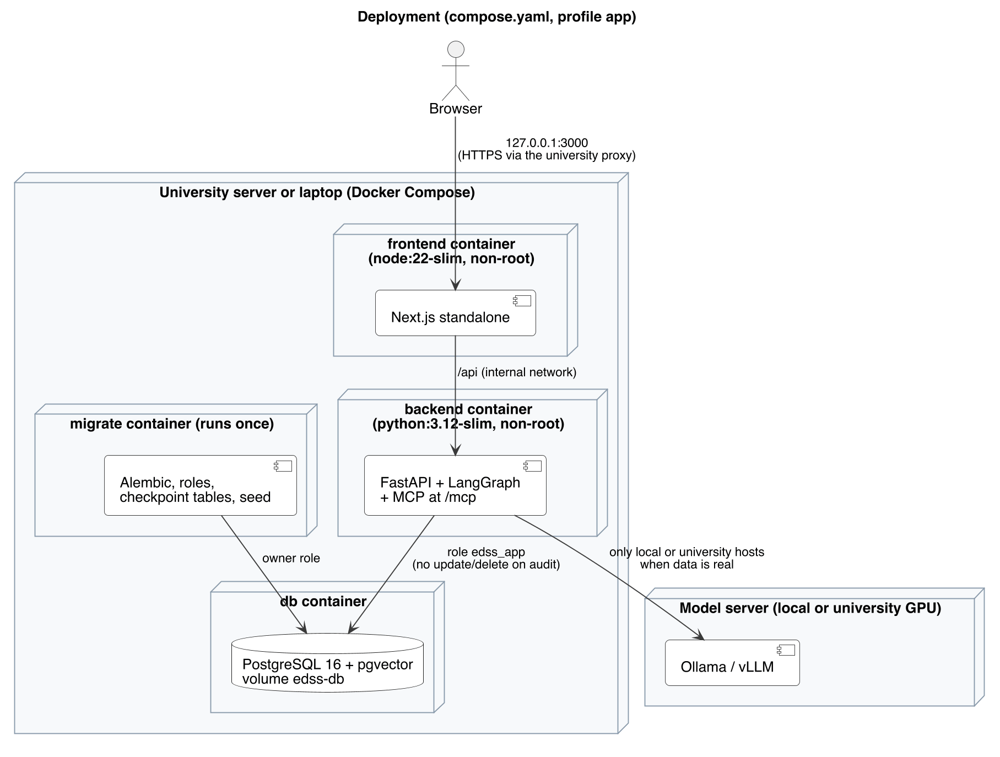

# 12. Deployment and operations

Full operating steps for the university IT cell are in `docs/RUNBOOK.md`. Diagram: `uml/png/12_deployment.png`.

| Container | What it runs | Reachable from |
| --- | --- | --- |
| `db` | PostgreSQL 16 with pgvector, data in the `edss-db` volume | 127.0.0.1 only |
| `migrate` | Once per start: migrations, the app role's password, checkpoint tables, the synthetic sample | Nothing; it exits |
| `backend` | FastAPI with the agent graph and the MCP server, as role `edss_app` | Only the web app, inside Docker |
| `frontend` | Next.js standalone server | 127.0.0.1:3000 by default |

| Operation | Command | Proof |
| --- | --- | --- |
| Start everything | `make up` | healthy in about 30 seconds after the first build |
| Prove from a fresh clone | `make smoke` | clones, builds, signs in, runs a brief, verifies the audit chain, backs up and restores |
| Back up | `make db-backup` | restores into a throwaway database, compares every table, verifies the chain |
| Load real data | `make ingest DIR=data/real/<folder>` then `ARGS=--db` | reconciliation report; the first real load switches the database to real mode, once |
| First administrator | `make create-user ARGS="--email ... --role admin"` | password asked twice, never shown; audit row written |
| The live demo | `make demo` | `docs/DEMO.md`, rehearsed by `make rehearse` |

Not ready yet (said plainly): official KPI definitions, single sign-on, HTTPS (needs the university's proxy and certificate), and more than one API process (decision D31).
