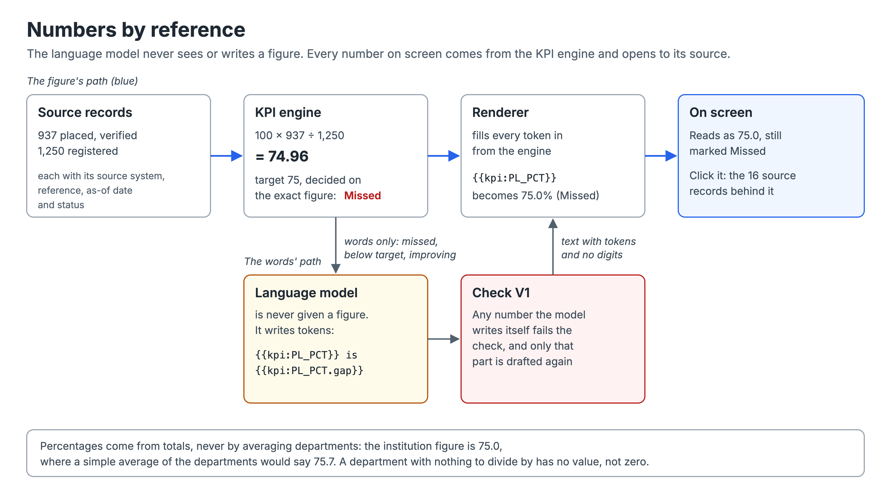
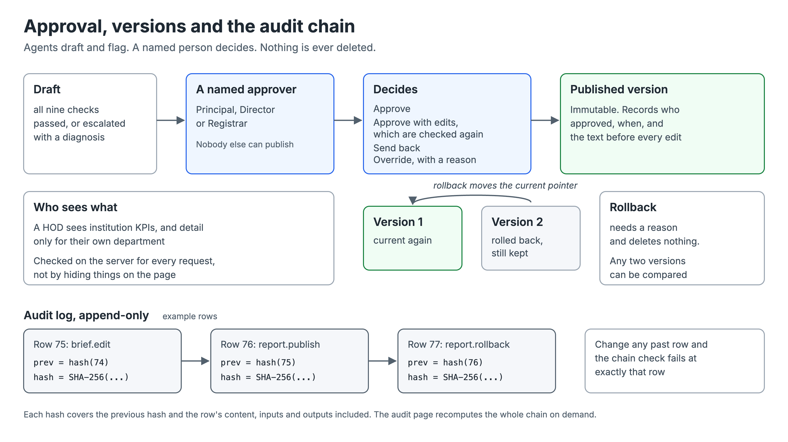
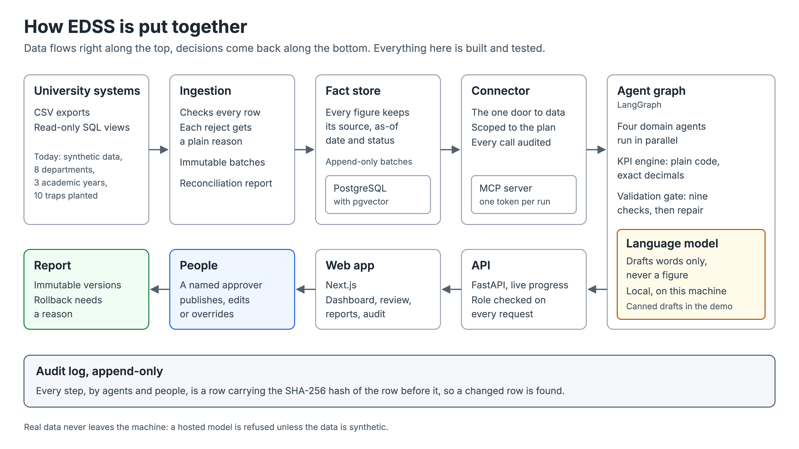
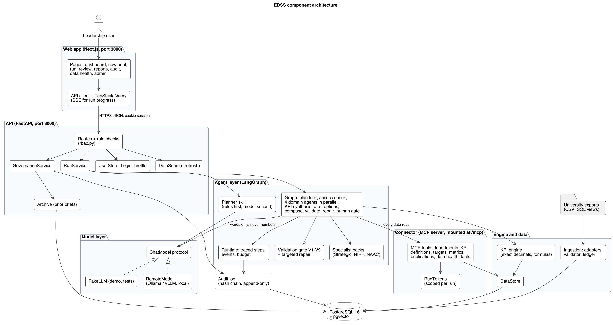
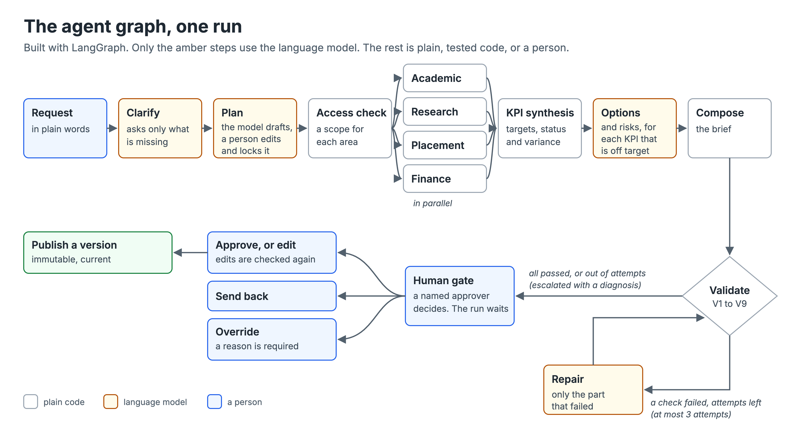
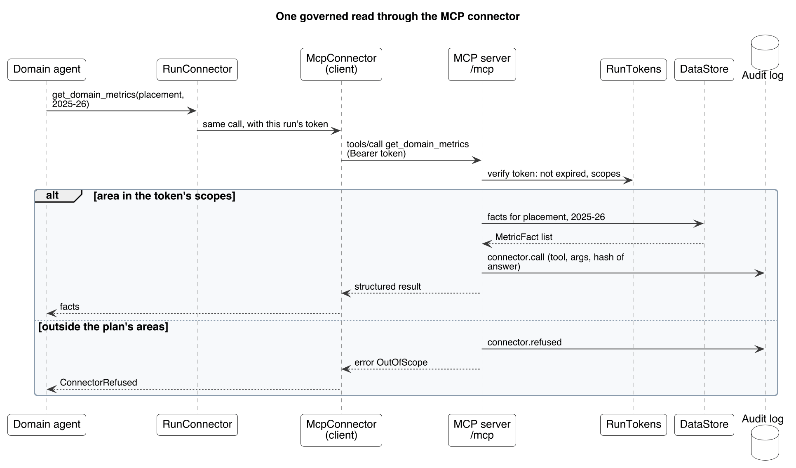
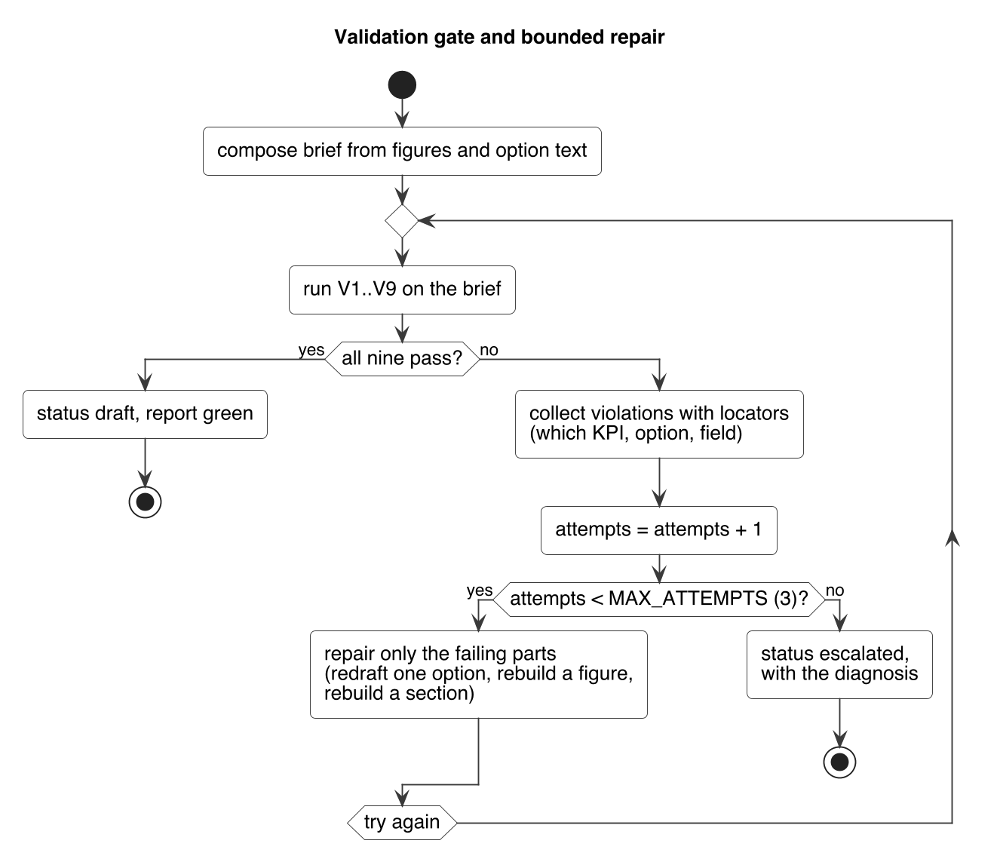
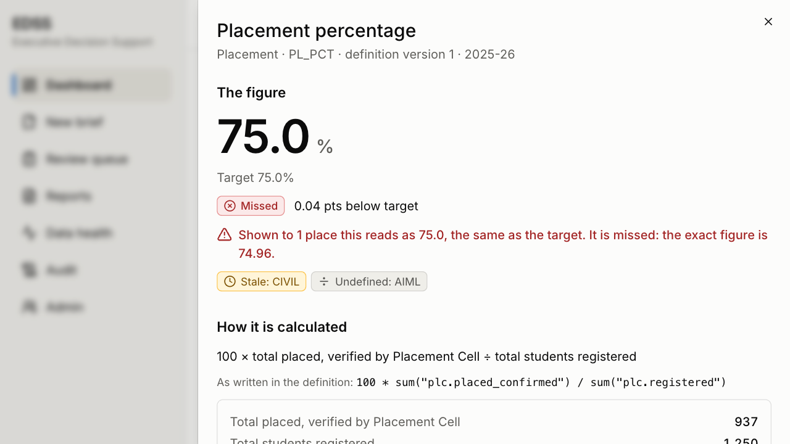
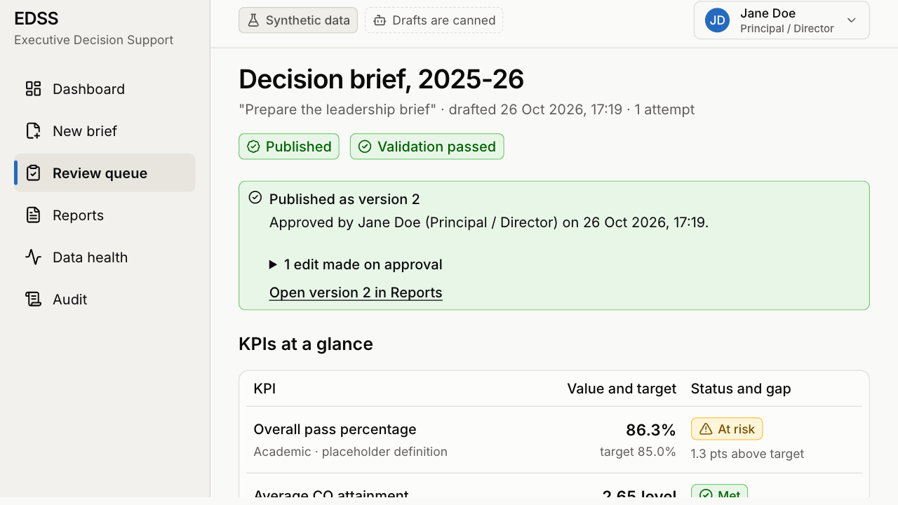

# Executive Decision Support System (EDSS)

## Final Course Project Report

**Course:** Agentic AI (26ECAC401)<br>
**Programme:** B.E. Computer Science and Engineering (AI), 7th Semester, Division B<br>
**Institution:** KLE Technological University<br>
**Worklet:** Chapter 15, Executive Decision Support System (Agentic AI Worklets, 14-Lab Build Book)

| Team member | USN |
| --- | --- |
| Kiran Patil | 01FE24BCI407 |
| Mudassir | 01FE23BCI008 |
| Sakshi Manvi | 01FE23BCI013 |
| Nazreen | 01FE23BCI026 |

**Repository:** https://github.com/kirann-05/edss

---

## Abstract

University leadership reviews academic, research, placement and finance performance from separate departmental reports that arrive on different schedules and in different formats. No single view shows institution-wide KPIs against NIRF, NAAC and strategic-plan targets. Figures are often weeks old by the time the Governing Council sees them, and provisional numbers can be mistaken for final ones.

This project builds the **Executive Decision Support System (EDSS)**, a governed multi-agent system that turns a leadership request into a validated, evidence-grounded **decision brief with options and risks**, which a named human must approve before it is published. Four domain agents (Academic, Research, Placement, Finance) gather data in parallel through a single MCP connector. A deterministic KPI engine computes every figure. A language model writes only words around reference tokens and never produces a number. A nine-check validation gate with bounded self-repair guards every draft. The Principal, Director or Registrar approves, edits, overrides or sends the draft back. Approved briefs become immutable, versioned reports with one-click rollback and a hash-chained audit log.

The system was grown through the 14 labs of the build book. It runs as a FastAPI and LangGraph backend with a Next.js frontend on PostgreSQL with pgvector, packaged with Docker Compose. In the latest full test run, all 1,392 automated tests passed. 94 of 94 injected faults were caught by the intended check and repaired within the retry budget. The parallel domain phase was 4.0 times faster than running the agents one at a time, and backend line coverage was 98 percent.

---

## 1. Introduction

### 1.1 Background

Agentic AI systems differ from chatbots in that they plan, act through tools, observe results and revise, inside an explicit control loop. The course teaches this through a 14-lab method in which every worklet is built as a coordinator-plus-workers system and grown one capability at a time across four phases:

| Phase | Labs | What it establishes |
| --- | --- | --- |
| A. Foundations | 1 to 6 | Agent loop, tools, skills, memory, one connector for all data, a governed runtime with an audit log |
| B. Orchestration | 7 to 8 | An explicit node graph, then parallel per-unit work with a merge |
| C. Applied reliability | 9 to 11 | Evidence grounding, self-healing on validation failure, the spec as a tested build |
| D. Governance and capstone | 12 to 14 | Approval, evaluation and rollback; domain specialists; an integrated, deployed system |

The guiding principle across all worklets is: **agents draft and flag; a named human approves.**

### 1.2 Motivation

An executive decision is only as good as the numbers behind it. Leadership needs a current, consolidated and traceable view. Language models are good at drafting text but unreliable with arithmetic and prone to stating unsupported figures. EDSS therefore keeps the model on what it does well (wording options and risks) and keeps every number in deterministic, tested code.

---

## 2. Problem Statement

The problem statement document is Chapter 15 of the 14-Lab Build Book, included in this folder as [`../Problem_Statement/Chapter15_EDSS_Problem_Statement.pdf`](../Problem_Statement/Chapter15_EDSS_Problem_Statement.pdf).

> **Executive Decision Support System.** One real-time, drill-down view of institution-wide KPIs against NIRF/NAAC and strategic-plan targets.
> Human authority: the executive / leadership. Primary output: decision brief with options and risks.
> Stakeholders: Principal/Director, Registrar, Deans, Governing Council.

**Problems heard from stakeholders**

1. Leadership reviews performance from separate departmental reports on different schedules and in different formats.
2. There is no single, real-time view of institution-wide KPIs against NIRF/NAAC or strategic-plan targets.
3. By the time a consolidated report reaches the Governing Council, the numbers are already weeks old.
4. Drilling down from a KPI to the department or root cause requires going back to each department separately.
5. Provisional, forecast or unreconciled figures can be mistaken for final ones.

**Definition of done (Lab 14):** for a real case, the worklet turns a request into a validated, evidence-grounded decision brief that the named human authority approves, and the result is published in a governed, versioned and auditable way.

---

## 3. Objectives

1. **Consolidate** academic, research, placement and finance data from all departments into one institution-wide view, gathered in parallel through one governed connector.
2. **Compute** institution-wide KPIs deterministically, with target, variance and status, aggregating percentages from numerators and denominators and never by averaging department percentages.
3. **Draft** a leadership-ready decision brief with two or three options, risks, trade-offs and assumptions for every off-target KPI, without the language model ever writing a number.
4. **Ground** every figure in evidence: source system, source reference, as-of date and status, reachable by drill-down from KPI to department to record.
5. **Validate** every draft against a hard gate of nine checks, repair failures automatically within a bounded budget, and escalate to a person when the budget is spent.
6. **Govern** publication: only an authorised role may approve, edit or override; reports are versioned, reversible and recorded in an append-only, hash-chained audit log.
7. **Protect** institutional data: real data never leaves the machine, models run locally, and no external tracing is used.
8. **Deliver** a deployable system with a dashboard, live run progress, an approval screen, an audit viewer and a reproducible test suite.

---

## 4. Requirements

### 4.1 Users and roles

| Role | Permissions |
| --- | --- |
| Registrar | Authorise data areas, request briefs, review, approve, roll back, read the audit log, refresh data |
| Principal / Director | Request briefs, review, approve, edit, override, roll back, read the audit log |
| Dean | Request briefs, see institution KPIs and their school's detail |
| Head of Department | See institution KPIs and their own department's detail only; cannot approve |
| Governing Council member | Read approved, published reports only |
| Administrator | Manage people and roles, see data health; cannot see figures or approve |

### 4.2 Functional requirements (summary)

| ID | Requirement |
| --- | --- |
| FR-1 | Free-text request; the agent asks clarifying questions and proposes an editable plan that a person locks |
| FR-2 | Registrar-authorised read scope per data area before a run starts |
| FR-3 | Four domain agents gather data in parallel and return typed views with data-health flags |
| FR-4 | Deterministic KPI synthesis with target, variance and status |
| FR-5 | Decision brief: KPI summary, options with risks and trade-offs, assumptions, data health |
| FR-6 | Drill-down from KPI to department to source record |
| FR-7 | Validation gate V1 to V9, targeted repair within 3 attempts, escalation on exhaustion |
| FR-8 | Human gate: approve, edit, override (with reason) or send back, role-checked |
| FR-9 | Governed publish: immutable versions, current pointer, rollback with a reason |
| FR-10 to FR-18 | Dashboard, data health, audit viewer, checkpoint and resume, PDF export, role scoping, ingestion with reconciliation, real-data loading, similar past briefs by vector search |

All 18 functional requirements are built. The full list, 12 non-functional requirements and the traceability matrix are in [`../docs/technical/01-requirements.md`](../docs/technical/01-requirements.md) and [`../docs/technical/11-traceability.md`](../docs/technical/11-traceability.md).

### 4.3 Non-negotiable design rules

1. The language model never produces, computes or rounds a number. Figures reach the text by reference tokens (`{{kpi:KEY}}`, `{{fact:ID}}`).
2. Agents draft and flag; a named human approves. Nothing is published without an approval record from an authorised role.
3. Every figure traces to a source: metric fact id, source system, source reference, as-of date, status.
4. Provisional, forecast and unreconciled figures are never shown as final.
5. A missed target is never hidden by rounding; status is decided on unrounded values.
6. No agent touches a data source directly; everything goes through the connector.
7. Real data never leaves the machine; hosted models only on synthetic data, enforced in code.
8. Retries are bounded (3); on exhaustion the draft is escalated with a diagnosis.
9. The audit log is append-only and hash-chained.
10. Validation is a hard gate.
11. Percentages are aggregated from numerators and denominators.
12. NIRF and NAAC definitions are never invented; placeholders remain until IQAC supplies them.

---

## 5. Approach

### 5.1 Method

The system was built in **vertical slices** (data to KPI to brief to user interface for one KPI, then wider), following the 14 labs as milestones. Tests were written first for the KPI engine and every validation check. Each design choice with real trade-offs was recorded with its alternatives (decisions D1 to D34 in [`../docs/DECISIONS.md`](../docs/DECISIONS.md)).

The 12 course assignments (Labs 1 to 12) were first built as small, standalone, standard-library Python prototypes (see [`../../Assignments/`](../../Assignments/)). Their concepts were then carried into the production system described below.

### 5.2 Key design idea: numbers by reference

The central risk in an LLM-written executive brief is an invented or mis-rounded figure. EDSS removes that risk by construction:

1. The KPI engine computes every figure with exact decimals from totals.
2. The model receives only KPI keys and qualitative context and writes text containing tokens such as `{{kpi:placement_pct}}`.
3. A number lint and check V1 reject any digit the model writes outside a token.
4. At render time each token is replaced by the engine's value and becomes a clickable link to its evidence.



### 5.3 Human authority and governance

The human gate is a real stop (a LangGraph interrupt), not a guardrail sentence. Validation runs before a person sees the draft. Every decision is role-checked on the server, and every step's inputs and outputs are written to a hash-chained audit log.



---

## 6. System Architecture



### 6.1 Layers

| Layer | Responsibility | Main code |
| --- | --- | --- |
| Web app | Pages for each role, drill-down, live run progress over SSE, approval screen | `frontend/src/app`, `frontend/src/components` |
| API | HTTP routes, sessions, role and department scoping, services | `backend/app/api`, `backend/app/services`, `backend/app/core/rbac.py` |
| Agent layer | Planner skill, LangGraph graph, option drafting, validation and repair, specialist packs, runtime tracing | `backend/app/agents`, `backend/app/specialists` |
| Connector | The only way agents read data: an MCP server with per-run scoped tokens; every call audited | `backend/app/mcp_connector` |
| Engine and data | KPI engine (formulas, exact decimals), data store, ingestion | `backend/app/kpi`, `backend/app/ingestion` |
| Governance | Approval, edit, override, versions, rollback, diff, archive, audit chain | `backend/app/governance` |
| Storage | PostgreSQL 16 with pgvector; LangGraph checkpoints; append-only audit table | `backend/app/db`, `backend/migrations` |
| Model layer | One `ChatModel` protocol: FakeLLM for demo and tests, a local OpenAI-compatible model (Ollama now, vLLM on a GPU later) | `backend/app/agents/llm.py` |



### 6.2 The agent graph



| Node | What it does | Uses the model |
| --- | --- | --- |
| `plan_lock` | Records the locked plan | No |
| `access_check` | Checks the Registrar's grants for each planned area | No |
| `domain_agent` x4 | Academic, Research, Placement and Finance in parallel (LangGraph `Send`), reading only through the connector | No |
| `kpi_synthesis` | The join: the KPI engine computes each planned KPI with target, variance and status | No |
| `draft_options` (per off-target KPI, in parallel) | Two or three options with risks, trade-offs and assumptions, guided by a specialist pack | Yes, words only |
| `report_compose` | Assembles the brief: figures, options, assumptions, data health | No |
| `validate` | Runs checks V1 to V9 | No |
| `regenerate` | Repairs only the failing parts; back to `validate` at most 3 times | Only to redraft an option |
| `prepare_gate`, `human_gate` | Creates the draft (green or escalated) and pauses for a person | No |
| `finish` | Records the decision | No |

The planner (clarify, propose, revise) runs before the graph. Rules read the request first, the model fills only what the rules could not, and a person edits and locks the plan.

### 6.3 The MCP connector

The connector is an MCP server (Python MCP SDK 2.3) mounted in the API at `/mcp`. Each run receives a bearer token scoped to its plan's data areas, which expires with the run. Tools include `get_domain_metrics`, `get_kpi_definitions`, `get_targets`, `get_publications`, `get_data_health`, `get_evidence` and `get_source`. Every call is audited with a hash of the answer, and a read outside the token's scope is refused and audited. A whole run gives identical KPIs through MCP and directly, which a test proves.



### 6.4 Technology stack

| Concern | Choice | Reason |
| --- | --- | --- |
| Orchestration | LangGraph | Parallel fan-out (`Send`), checkpoints that survive a restart, a built-in interrupt for the human gate |
| Connector | MCP (Python SDK) | One protocol for every source, scoped tokens per run (Lab 5) |
| API | FastAPI, Pydantic 2 | Typed contracts; the OpenAPI schema generates the frontend's types |
| Storage | PostgreSQL 16 + pgvector | Facts, runs, briefs, audit chain, checkpoints and similar-brief search in one database |
| Model | Ollama (qwen3.5 4B) locally; vLLM on a university GPU later | Real data never leaves the machine |
| Web app | Next.js, React, TypeScript, Tailwind, shadcn/ui, ECharts, TanStack Query | Typed end to end, accessible components, live progress over SSE |
| Tests | pytest, Vitest, Playwright with axe | Unit, component, browser and accessibility tests |
| Packaging | Docker Compose | One command on any server |

---

## 7. Implementation

### 7.1 Mapping of the 14 labs to the system

| Lab | Capability | Where it lives (under `backend/`) |
| --- | --- | --- |
| 1 | Planner loop: clarify, plan, revise, lock | `app/agents/skills/plan_skill.py`, `app/services/runs.py` |
| 2 | Tool-using agent and KPI engine | `app/agents/graph.py`, `app/kpi/engine.py`, `app/kpi/formulas.py` |
| 3 | Reusable skills with a contract | `app/agents/skills/plan_skill.py`, `options_skill.py`, `app/agents/prompts.py` |
| 4 | Memory split: run state vs archive of prior briefs | Graph checkpoints; `app/services/archive.py`, `app/db/archive_store.py` (pgvector) |
| 5 | MCP connector | `app/mcp_connector/`, `app/ingestion/` |
| 6 | Governed runtime with audit and checkpoints | `app/agents/runtime.py`, `app/governance/audit.py` |
| 7 | Full node graph | `app/agents/graph.py` |
| 8 | Parallel fan-out and merge | `Send` fan-out in `graph.py` |
| 9 | Grounding and evidence | `app/agents/tokens.py`, check V1 |
| 10 | Validate, diagnose, repair | `app/agents/validation/checks.py`, `faults.py`, `app/agents/repair.py` |
| 11 | Spec to tested output | V1 to V9 as a hard gate; `scripts/acceptance.py` |
| 12 | Safety, approval, rollback | `app/governance/service.py`, `app/core/rbac.py` |
| 13 | Specialist packs | `app/specialists/` and `packs/` (Strategic, NIRF, NAAC) |
| 14 | Capstone: integrated, deployed system | `compose.yaml`, Dockerfiles, `docs/RUNBOOK.md` |

### 7.2 The validation gate

| Check | What it guarantees |
| --- | --- |
| V1 | No number in the text outside a reference token |
| V2 | Every planned area and department is covered, or its gap is stated |
| V3 | Every off-target KPI has options, each with risks and trade-offs |
| V4 | Provisional, forecast and unreconciled figures carry their status, never shown as final |
| V5 | No approval is claimed without an approval record |
| V6 | Status is decided on unrounded values, so a miss is never rounded into a pass |
| V7 | Every figure has a source record |
| V8 | Stale or missing departments are disclosed in the data health section |
| V9 | No double counting (for example, a paper shared by two departments) |

When a check fails, the diagnosis names the failing part and `regenerate` repairs only that part, up to three attempts. Integrity failures (V1, V4, V5, V6, V7, V9) can never be approved past; completeness failures (V2, V3, V8) can be approved only with the approver's recorded acknowledgement.



### 7.3 Data and synthetic traps

Until the university supplies real data, the system runs on a synthetic institution with ten planted traps, for example a placement rate of 74.96 percent against a 75 percent target, a provisional finance figure, a stale department and a paper co-authored across two departments. Each trap exists to prove that a specific check works. Real data is loaded with `make ingest`, which validates every row, produces a reconciliation report and switches the database to real mode once.

### 7.4 User interface

The web app provides a dashboard of institution KPIs with variance and drill-down, a New Brief page with the clarifying conversation and editable plan, a live run timeline, a review queue and brief review screen with evidence and prior briefs tabs, reports with version compare, rollback and print to PDF, an audit viewer with chain verification, a data health page and people administration. Screens are in [`../docs/demo-screens/`](../docs/demo-screens/).





### 7.5 Repository layout

```
Course_Project/
  backend/     FastAPI + LangGraph + MCP (Python 3.12, uv)
  frontend/    Next.js web app (TypeScript, pnpm)
  scripts/     seed, ingest, acceptance, benchmark, evaluate_llm, demo
  data/sample/ synthetic institutional data with planted traps
  shared/      figure formatting vectors shared by backend and frontend tests
  docs/        specification, architecture, decisions, technical dossier, UML, demo
  compose.yaml, Makefile
```

---

## 8. Testing and Results

### 8.1 Test strategy

| Level | What is tested | Tool |
| --- | --- | --- |
| Unit | KPI engine, each validation check, tokens, planner, repair, audit chain, ingestion | pytest, Vitest |
| Component | Decision dialogs, run timeline, rich text with figure tokens | Vitest, Testing Library |
| API integration | Every route with every role: permissions, scoping, approval, rollback | pytest |
| Database integration | The API suite on PostgreSQL; migrations; audit role and trigger; backup and restore | pytest |
| End to end | Approval flow, fault injection, scoping, keyboard use, accessibility (axe) | Playwright |
| Fault injection | Every fault into every plan it applies to | `scripts/acceptance.py` |
| Performance | Parallel against one-at-a-time domain agents | `scripts/benchmark.py` |
| Deployment | A fresh clone built into containers, used, backed up and restored | `scripts/smoke_clean_clone.sh` |

### 8.2 Results

| Suite | Result |
| --- | --- |
| Backend unit and integration tests | 1,136 passed (2 skipped by design) |
| Web unit and component tests | 238 passed |
| Browser (end-to-end) tests | 18 passed |
| Database layer tests | 68 passed |
| API suite in database mode | 242 passed |
| Demo rehearsal (9 steps in a browser) | Passed |
| Fault injection | 94 of 94 caught by the intended check and repaired |
| Backend line coverage | 98 percent |
| Fresh clone in containers | Passed |

In total: **1,392 automated tests, all passing.** Raw logs are in [`../docs/technical/results/2026-10-27/`](../docs/technical/results/2026-10-27/).

### 8.3 Fault injection

18 plans and 113 graph runs in 1.2 seconds.

| Measure | Result |
| --- | --- |
| Clean drafts passing all nine checks first time | 18 of 18 |
| Fault trials caught on the first attempt | 94 of 94 |
| Caught by the check meant to catch it | 94 of 94 |
| Repaired within the budget of 3 | 94 of 94 |
| Escalated to a person | 0 |

| Injected fault | Caught by |
| --- | --- |
| A figure written by hand | V1 |
| A figure with no source | V7 |
| A provisional figure called confirmed | V4 |
| An option with no risks | V3 |
| A stale department hidden | V2, V8 |
| A shared paper counted twice | V9 |
| A miss rounded into a pass | V6 |
| Approval claimed without a record | V5 |

### 8.4 Parallelism benchmark

| Simulated delay per source | Parallel | One at a time | Speed-up |
| --- | --- | --- | --- |
| 250 ms | 258 ms | 1,025 ms | 4.0x |
| 700 ms | 709 ms | 2,821 ms | 4.0x |
| 1,000 ms | 1,007 ms | 4,021 ms | 4.0x |

Four agents waiting the same time can be at most four times faster, so this is the best possible result.

### 8.5 Local model evaluation

With qwen3.5 (4B) through Ollama on a laptop and synthetic data only: 9 of 9 option drafts passed all nine checks. The model alone asked the right clarifying questions 4 times in 10. The hybrid planner (rules first, model second) reached 9 in 10, with 6 model calls instead of 16. A full brief with the real model takes about a minute; the demo uses the deterministic FakeLLM so that it runs in about a second.

### 8.6 Course assignment prototypes

All 12 assignment prototypes and the two bridge labs (13, 14) run successfully, each printing its acceptance line, and their 9 unit tests pass (`python Assignments/run_all.py`, `python -m pytest Assignments/lab_kit/tests`).

---

## 9. Discussion

**What worked well.** Keeping numbers out of the model removed the most dangerous failure mode by construction rather than by prompting. A hard validation gate with targeted repair made the pipeline self-healing without unbounded loops. LangGraph's `Send`, checkpoints and interrupt mapped directly onto Labs 7, 8, 6 and 12.

**Where we read the book differently.**
- Lab 8 asks for best-of-N candidate merging. That suits generated text, not KPI arithmetic, so here the domain agents and option drafts run in parallel and merge by plan coverage.
- Lab 13 describes domain packs. Here they are framework packs (Strategic plan, NIRF, NAAC). The NIRF and NAAC packs stay empty until IQAC supplies definitions, because inventing them is forbidden.
- The book's pseudocode runs human review before validation. Here validation is a hard gate before any person sees a draft.

**Limitations, stated plainly.**
- All 13 KPI definitions and targets are placeholders (`PLACEHOLDER_PENDING_IQAC`) until IQAC supplies official ones.
- Real university data has not yet been loaded; the real-data path is tested with exported synthetic files.
- Model quality is measured with a 4B model on a laptop; the production GPU model must be measured again.
- University single sign-on and HTTPS termination are not yet in place.

---

## 10. Conclusion

EDSS meets the Chapter 15 definition of done on synthetic data. A request becomes a clarified, locked plan. Four agents gather data in parallel through one governed connector, and a deterministic engine computes every KPI. The model drafts options and risks without touching a number. A nine-check gate validates and repairs the draft, a named leader approves it, and the result is published as a versioned, reversible and fully audited report. The project shows that agentic systems can be trusted with executive reporting when their autonomy is bounded by deterministic computation, explicit validation and human authority.

## 11. Future Work

1. Load real departmental data and the official IQAC KPI definitions and targets, and fill the NIRF and NAAC specialist packs.
2. Deploy on university infrastructure with a GPU-served model (vLLM), single sign-on and HTTPS.
3. Schedule ingestion and refresh, and add email distribution of approved reports to the Governing Council.
4. Extend the system to other departments and institutions.

## 12. References

1. *Agentic AI Worklets, 14-Lab Build Book*, Chapter 15: Executive Decision Support System (course material).
2. LangGraph documentation, LangChain Inc. https://langchain-ai.github.io/langgraph/
3. Model Context Protocol specification and Python SDK. https://modelcontextprotocol.io/
4. FastAPI documentation. https://fastapi.tiangolo.com/
5. PostgreSQL 16 and pgvector documentation. https://www.postgresql.org/docs/16/, https://github.com/pgvector/pgvector
6. Next.js documentation. https://nextjs.org/docs
7. National Institutional Ranking Framework (NIRF), Ministry of Education, Government of India. https://www.nirfindia.org/
8. National Assessment and Accreditation Council (NAAC). http://www.naac.gov.in/

## Appendix A. Further documentation

| Document | Path |
| --- | --- |
| Technical dossier (requirements, design, UML, API, database, testing) | [`../docs/technical/`](../docs/technical/) |
| Specification | [`../docs/SPEC.md`](../docs/SPEC.md) |
| Architecture narrative | [`../docs/ARCHITECTURE.md`](../docs/ARCHITECTURE.md) |
| Design decisions D1 to D34 | [`../docs/DECISIONS.md`](../docs/DECISIONS.md) |
| The 14 labs and how to show each | [`../docs/LABS.md`](../docs/LABS.md) |
| Live demo script | [`../docs/DEMO.md`](../docs/DEMO.md) |
| Operations runbook | [`../docs/RUNBOOK.md`](../docs/RUNBOOK.md) |
