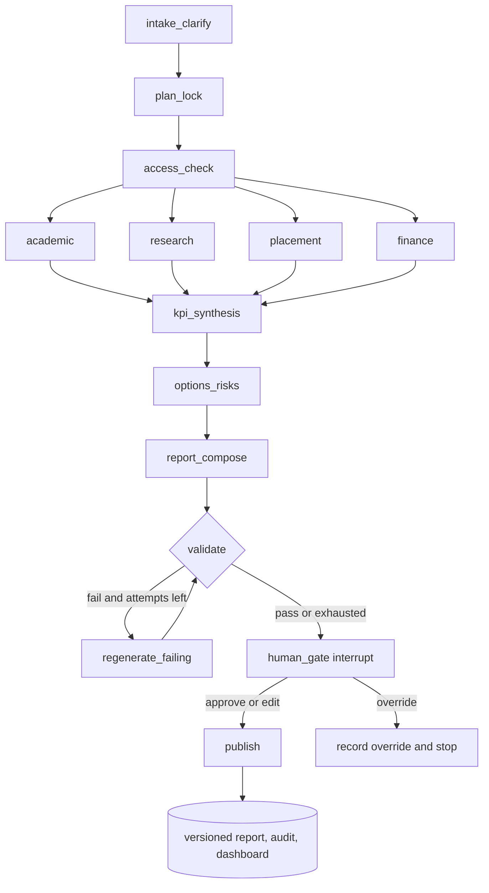

# ARCHITECTURE

Everything here is provisional where docs/DECISIONS.md says so. The principles are not.

## 1. Principles

1. Deterministic where it can be, agentic where it adds value. KPI math, aggregation, variance, versioning and checks are plain tested code. The LLM clarifies requests, drafts options and risks, and explains. Be honest about this split; it is the defence against hallucinated numbers.
2. Numbers by reference. The LLM output contains tokens like `{{kpi:AC_PASS_PCT}}` or `{{fact:8841}}`. A renderer resolves them from the database. A lint rejects any other digit in LLM text (allowlist: financial year labels, dates). That lint is check V1.
3. Ingest, then serve. Source systems are read by adapters into immutable, batch-versioned `metric_fact` rows. The connector serves from that store. Runs are reproducible and evidence ids never change under a report. "Real-time" means the ingestion cadence plus an on-demand refresh button, with an as-of date on every figure.
4. One door to data. Agents reach data only through the connector. A test fails the build if an agent module imports a database or file reader.
5. Provider-agnostic LLM. One factory, one interface, swapped by config.

## 2. Layers

| Layer | Component | Notes |
| --- | --- | --- |
| Sources | CSV or Excel drop folder, read-only SQL views, optional API | Adapters, one class each |
| Ingestion | Validator and loader | Rejects rows missing status or as_of, records batch id and source ref |
| Store | PostgreSQL 16 with pgvector | Facts, KPI defs, targets, results, runs, briefs, versions, audit, users |
| Connector | MCP server | Typed read tools, scoped tokens, every call audited |
| KPI engine | Python package | Safe formula evaluation (no eval), Decimal arithmetic, weighted aggregation |
| Agent graph | LangGraph | See section 3 |
| LLM layer | Provider factory | Ollama or vLLM through an OpenAI-compatible endpoint, hosted only in synthetic mode |
| API | FastAPI | REST plus SSE for run progress |
| UI | Next.js | See docs/UI_SPEC.md |
| Governance | Versioning, rollback, audit, RBAC | Hash-chained audit table |

## 3. Agent graph



Notes:

- The Coordinator is the graph plus the runtime wrapper (budgets, audit, checkpoints). It is not a separate LLM agent. Say this plainly in the viva.
- `access_check` is sequential. The four domain nodes run in parallel using LangGraph's fan-out (`Send`) with a join before `kpi_synthesis`.
- `options_risks` fans out per off-target KPI so options are drafted in parallel.
- On exhaustion, the graph still reaches the human gate, flagged `escalated` with the diagnosis. The human can override or send it back.
- `human_gate` uses LangGraph's interrupt. Resume carries the decision, the actor, edits and the reason.

### State (Pydantic)

```
RunState:
  run_id, request, clarifications[], plan (locked, immutable after plan_lock)
  scope: {domain: ScopeGrant}
  domain_views: dict[domain, DomainView]      # merged by a dict reducer
  kpi_results: list[KpiResult]
  options: list[OptionSet]                    # per KPI
  brief: Brief (draft)
  validation: ValidationReport | None
  attempts: int
  gate: GateDecision | None
  published_version: int | None
```

Run state (short term, checkpointed) is kept separate from the archive (long term: approved briefs, history, embeddings). Mixing them corrupts the baseline.

## 4. Connector (MCP server)

Tools, all read-only, all taking a scoped bearer token:

- `list_departments()`
- `get_domain_metrics(domain, period, dept=None)` returns facts with status, as_of, source ref
- `get_kpi_definitions(framework=None)`
- `get_targets(period, framework=None)`
- `get_external_benchmarks(framework)`
- `get_data_health(period)`: freshness and missing per department and domain
- `get_evidence(fact_id)`: the fact, its batch, its source ref

Each call writes an audit row (token subject, tool, arguments, result hash). Swapping a source means swapping an adapter in the ingestion layer. No agent changes.

## 5. LLM layer

`agents/llm.py` exposes `get_chat_model(role)` for roles `clarifier`, `drafter`, `judge`, and `get_embedder()`.

Config:

```
DATA_MODE=synthetic | real
LLM_PROVIDER=ollama | openai_compat | hosted
LLM_BASE_URL=http://localhost:11434/v1
LLM_MODEL=<chosen after checking what the hardware can serve>
LLM_EMBED_MODEL=<local embedding model>
ALLOW_HOSTED_LLM=false
```

Rules:

- The factory reads `data_mode` from the database `system_config` table, not only from the env. If data_mode is real and the provider is hosted, refuse to start and refuse at call time.
- Structured outputs through Pydantic with validation and a bounded repair retry. Temperature low. Small local models are weaker at tool calling, so the nodes that use the LLM take no tools. They take structured prompts and return structured JSON. Tools are called by deterministic nodes.
- A `FakeLLM` returns canned structured outputs for tests and for demo fallback. The whole graph must run end to end on FakeLLM in CI.
- Tracing: `LANGCHAIN_TRACING_V2=false` enforced at startup. Observability is the audit table and run trace UI.

## 6. Persistence

- PostgreSQL 16 with pgvector. SQLAlchemy 2 models, Alembic migrations.
- LangGraph checkpointer on Postgres (package names and APIs must be verified against current docs). SQLite is acceptable only for the first two days.
- Embeddings for Lab 4: local embedding model, stored in pgvector, used to retrieve similar past briefs and KPIs ("previously proposed options and what leadership did").

## 7. Governance

- Brief states: `draft`, `escalated`, `approved`, `published`, `rolled_back`, `overridden`.
- Publish creates an immutable `brief_version`. A `current_version` pointer moves forward. Rollback moves the pointer and writes an audit row. History is never edited.
- Approval requires a role with `can_approve` and a draft with a green validation report (or an `escalated` flag acknowledged by the approver).
- Audit table is append-only with `prev_hash` and `hash` per row. A verifier script recomputes the chain. The database role used by the app has no UPDATE or DELETE on the audit table.

## 8. Repo layout

```
edss/
  CLAUDE.md  PROGRESS.md  Makefile  docker-compose.yml  .env.example
  docs/
  backend/
    pyproject.toml
    app/
      api/            routers: runs, kpis, briefs, drilldown, audit, health, auth, admin
      core/           config, security, rbac, logging
      db/             models, migrations
      ingestion/      adapters (csv, sql), validators, loader
      connector/      mcp_server.py, tools, auth
      kpi/            engine.py, formulas.py, definitions/ (seed yaml)
      agents/
        graph.py  state.py  llm.py  runtime.py
        nodes/        intake, plan, access, academic, research, placement, finance,
                      kpi, options_risks, report, validate, regenerate, gate, publish
        skills/       plan_skill.py, format_decision_skill.py
        specialists/  registry.py, nirf.py, naac.py, strategic.py
      validation/     v1_sources.py ... v9_dedup.py, suite.py, fault_injection.py
      governance/     versioning.py, rollback.py, audit.py
      synthetic/      generator.py, traps.py
    tests/
  frontend/           Next.js app
  data/
    sample/           synthetic, committed
    real/             gitignored, never committed
  scripts/            benchmark_parallel.py, verify_audit_chain.py, backup.sh
```

## 9. Deployment target

Docker Compose with services `db`, `backend`, `connector`, `frontend`, and `llm` (or the host's Ollama or vLLM). Everything configured by env. Health checks on each service. A backup script for the database. A short runbook for the university IT cell. Production hardware is unknown, so size nothing until the open questions in docs/DECISIONS.md are answered.

## 10. Testing

- Unit: KPI engine, every validation check, RBAC, formula safety.
- Integration: the graph on FakeLLM with the synthetic dataset, including crash and resume.
- Failure injection: inject a fake number, a dropped source, a provisional figure described as final, a missing risks list, a stale department hidden, a double-counted paper, a rounded miss, an approval bypass. Every one must be detected.
- E2E: one Playwright flow, login as Principal, open draft, approve, see published version, roll back.
- Benchmark: parallel versus sequential domain aggregation, reported with numbers.

## 11. Security notes

Parameterised queries only. Formula evaluator is a restricted AST evaluator, never `eval`. Tokens scoped per tool and per department set. Secrets from env, never committed. Uploaded files validated by type and size. Authorisation tests for every route, especially HOD scoping.
